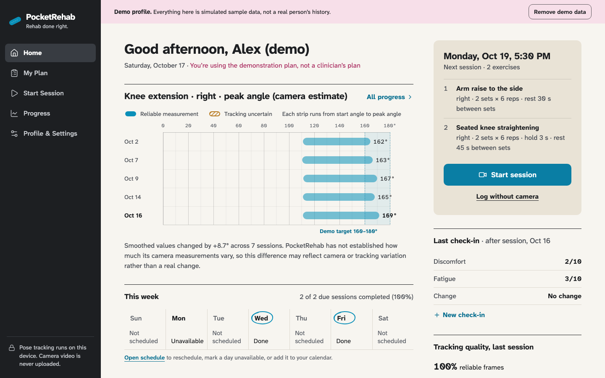
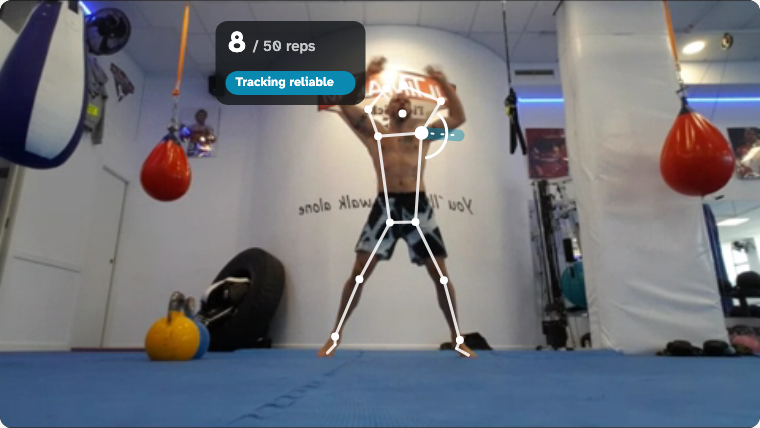
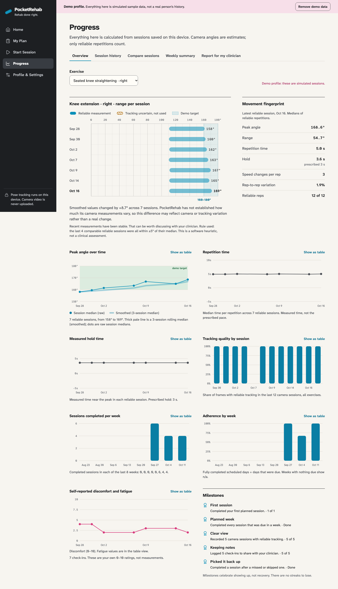
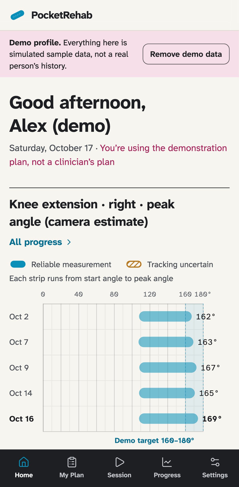

# PocketRehab — Rehab done right.

PocketRehab helps people follow the rehab plan their physical therapist gave them at home. It uses the laptop or phone camera to count repetitions and estimate joint angles **on the device**, shows an augmented-reality guide on top of the live video, and turns sessions into an honest report to bring to the next appointment.

Its difference from a rep counter: **every measurement carries a tracking-quality state** (reliable, uncertain or unavailable). If the camera can't see the movement well, PocketRehab says so, never gives form feedback, and leaves that data out of the user's progress. It also refuses to call a small change "improvement" until its own measurement error has been established.

**Live app:** https://sanjayk57.github.io/PocketRehab/ (works in Chrome, Edge, Safari and Firefox on Mac, Windows, Linux, iPhone, iPad and Android; installable as an app)

Built by **Sanjay Koripelli** for the 2026 Congressional App Challenge (KY-3). The idea comes from a personal and family connection to home physical therapy, where it's hard to know whether you're doing the exercises right and hard to show your therapist what happened between visits.

| Home | Live session with AR (real person, real tracking) |
|---|---|
|  |  |
| **Progress** | **Phone** |
|  |  |

> PocketRehab supports adherence to a rehabilitation plan provided or approved by a qualified healthcare professional. Its camera measurements and coaching may be inaccurate and do not replace professional assessment. Follow your clinician's instructions and stop if you experience concerning symptoms.

## What it does

- **Follows your clinician's plan.** Enter exercises, sets, reps, holds, rest and optional target angles exactly as your therapist gave them, with who approved them. Every change is kept as a new version. No clinician plan yet? A clearly labelled demonstration plan lets you try the software.
- **Camera tracking with AR, entirely on the device.** Google's MediaPipe pose model runs in the browser. The live view draws your skeleton, the joint angle as an arc, the target zone anchored to your joint, a ghost guide showing where the movement goes, and a floating rep counter with a tracking badge. Video is never recorded or uploaded.
- **Confidence-aware coaching.** A setup checklist (person visible, joints visible, correct camera angle, in frame, enough light), live quality states, a three-state feedback light with text, spoken coaching in three styles, captions, voice commands (optional) and keyboard shortcuts. Uncertain tracking never produces form feedback.
- **Safety first.** Short check-ins before and after sessions. Warning signs stop the session and point to emergency or care-team help; new or worsening symptoms pause it. PocketRehab never diagnoses, prescribes or changes treatment, and never pushes anyone through symptoms.
- **Honest progress.** Range "tape strips" per session, trends with labelled smoothing, repetition timing, hold time, smoothness and consistency, left/right comparison, session-to-session comparison with comparability warnings, weekly summaries, and milestones without streak pressure. Charts appear only from saved data, with table views for screen readers.
- **Scheduling.** Weekly plan, reschedule without stacking sessions, skip or mark unavailable, missed-session support without catch-up, in-app reminders and a calendar (.ics) export.
- **Reports for your therapist.** Choose the period, exercises and sections; download a PDF generated on the device or print it.
- **Private and accessible.** Local-only storage with export, restore and delete; no accounts, no tracking. Large readable type (Atkinson Hyperlegible, designed for low-vision readers), text size, contrast and motion settings, full keyboard use, and everything works without a camera or voice.

Full status (implemented, partial, not built): [docs/FEATURES.md](docs/FEATURES.md).

## Run it on your computer (Mac or Windows)

You need [Node.js](https://nodejs.org) 20 or newer (the LTS installer is fine on both Mac and Windows).

```bash
git clone https://github.com/SanjayK57/PocketRehab.git
cd PocketRehab
npm install
npm run dev
```

Then open http://localhost:5173 in Chrome, Edge, Safari or Firefox. Browsers only allow the camera on `https://` pages or on `localhost`, so the camera works at that address. To explore without entering anything, click **Explore the demo profile** on the welcome screen (clearly labelled sample data you can remove with one click).

To test on a phone on the same Wi-Fi, run `npm run dev -- --host` and open the printed network address. Phones only allow the camera over HTTPS, so for camera tests on a phone use the live GitHub Pages link instead.

### Install as an app

In Chrome or Edge, use the install icon in the address bar. On iPhone or iPad, use Share → Add to Home Screen. On Android, use the browser menu → Install app. After the first camera session, the app and the pose model work offline.

## Tests

```bash
npm run typecheck   # TypeScript strict mode
npm run lint        # ESLint (including React hooks rules)
npm test            # Vitest unit and integration tests
npm run evaluate    # evaluation harness → docs/EVALUATION.md
npx playwright install chromium   # first time only
npm run test:e2e    # Playwright browser tests (builds the app first)
npm run check       # typecheck + lint + unit tests + production build
```

The browser tests include a real-camera pipeline test using Chromium's fake camera. For the real-person test, first download the openly licensed clip with `sh scripts/fetch-test-video.sh` (needs `curl` and `ffmpeg`). Results and what was and wasn't tested: [docs/TESTING.md](docs/TESTING.md). Measured numbers: [docs/EVALUATION.md](docs/EVALUATION.md).

## Deploy

`npm run deploy` type-checks, runs the tests, builds with `BASE_PATH=/PocketRehab/` and publishes `dist/` to the `gh-pages` branch, which GitHub Pages serves over HTTPS. An equivalent GitHub Actions workflow is in `docs/ci/github-actions-deploy.yml` (move it to `.github/workflows/` to deploy on every push; that needs a token with the `workflow` scope). Any static host works: run `npm run build` and serve the `dist` folder over HTTPS (set `BASE_PATH` if it isn't served from the domain root).

## How it works

```
camera → MediaPipe pose (in the browser) → quality checks → joint angle → glitch filter + smoothing
       → repetition state machine → per-rep measurements → coaching + AR → saved locally → progress + reports
```

The movement-analysis engine is plain TypeScript with no UI dependencies, so it runs the same on live frames, simulated frames and test data. Details, formulas and the data model: [docs/ARCHITECTURE.md](docs/ARCHITECTURE.md). The visual system: [DESIGN.md](DESIGN.md).

## Limitations

- Joint angles are 2D estimates from a single camera. They are not clinically validated and can differ from a therapist's goniometer.
- Four movements have tested measurement definitions (arm raise to the side, bicep curl, seated knee straightening, sit to stand).
- Data stays in one browser on one device (export a backup to move it).
- Reminders only work while the app is open; use the calendar export for the rest.
- Tested in Chromium on a Mac at desktop, tablet and phone sizes. Safari, Firefox and real phones were not tested in this build.
- PocketRehab is a student project, not a medical device, and makes no HIPAA or regulatory claims.

## Credits and licenses

- Code: MIT License © 2026 Sanjay Koripelli (see [LICENSE](LICENSE)).
- Pose model and runtime: [MediaPipe](https://ai.google.dev/edge/mediapipe) Pose Landmarker by Google, Apache License 2.0.
- Typefaces: Atkinson Hyperlegible Next and Mono by the Braille Institute, SIL Open Font License.
- Libraries: React, React Router, Vite, Tailwind CSS, Zod, idb, jsPDF, jspdf-autotable, Lucide icons, Workbox / vite-plugin-pwa (all open source; see `package.json`).
- Test footage (not included in the repository): "Jumping jacks and burpees" by Taco fleur, CC BY-SA 4.0, via [Wikimedia Commons](https://commons.wikimedia.org/wiki/File:Jumping_jacks_and_burpees.webm). The app screenshots in `docs/screenshots/real-person-*.png` show frames from that clip with PocketRehab's overlay and are shared under the same CC BY-SA 4.0 license.
- Design process: visual direction chosen with the open-source [Impeccable](https://impeccable.style) design skill.
